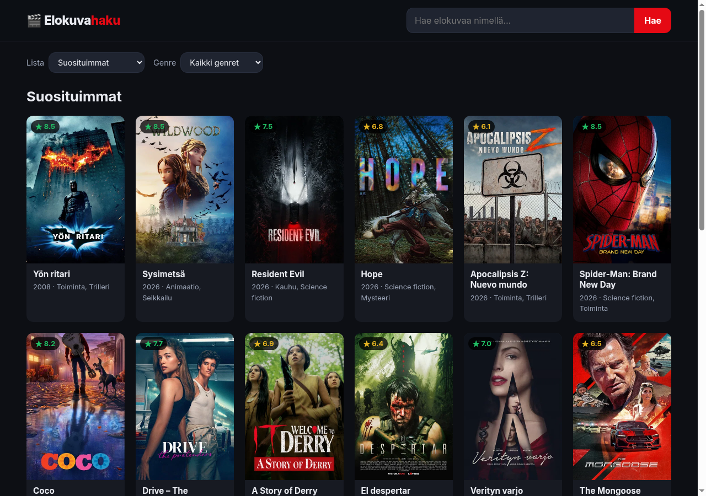
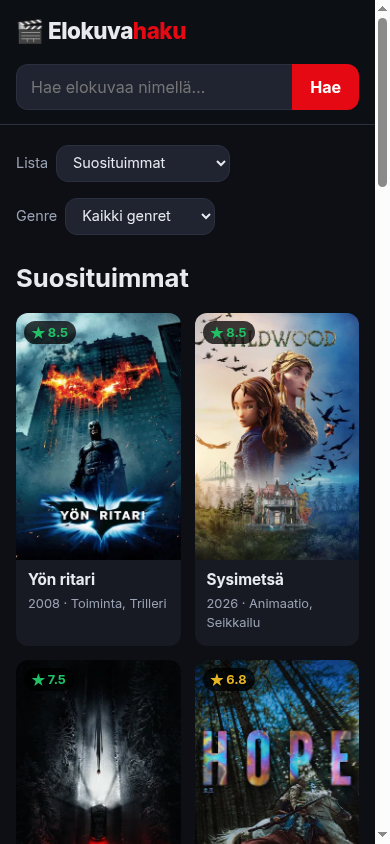

# Elokuvahaku

**Tekijä:** Joona Jehkonen

Web Development 1 -kurssin Projekti 2a: AJAX-sovellus, joka hakee dataa elävästä REST API:sta ([The Movie Database, TMDB](https://www.themoviedb.org/)).

## Linkit

- **Julkaistu sovellus:** https://dulcet-gingersnap-35b21e.netlify.app/
- **GitHub-repositorio:** https://github.com/jehkis/elokuvahaku
- **Esittelyvideo:** TODO: lisää videon linkki

## Projektisuunnitelma

### Idea

Elokuvahaku on selaimessa toimiva sovellus, jolla voi selata ja hakea elokuvia. Se on tarkoitettu kenelle tahansa, joka etsii katsottavaa tai haluaa tietää elokuvasta lisää: juonen, keston, näyttelijät ja trailerin. Tiedot haetaan suoraan TMDB:n rajapinnasta, joten ne ovat aina ajan tasalla.

### Ominaisuudet

- **Hakukenttä:** elokuvien haku nimellä (myös suomenkielisellä nimellä).
- **Listavalikko:** Suosituimmat, Parhaiten arvioidut, Teattereissa nyt ja Tulossa.
- **Genrevalikko:** genret haetaan rajapinnasta, ja valitun genren elokuvat näytetään suosituimmuusjärjestyksessä.
- **Elokuvan tiedot:** kortin klikkaus avaa ikkunan, jossa on taustakuva, juliste, arvosana, kesto, genret, ohjaaja, juoni, näyttelijät kuvineen ja YouTube-traileri.
- **Näytä lisää:** hakee seuraavan sivun tuloksia samasta hausta.
- Tiedot näytetään suomeksi (`language=fi-FI`). Jos suomenkielinen kuvaus puuttuu, näytetään englanninkielinen.

### Rautalankakaavio

```
+------------------------------------------------------------------+
| 🎬 Elokuvahaku                    [ Hae elokuvaa nimellä… ][Hae] |
+------------------------------------------------------------------+
| Lista [Suosituimmat v]   Genre [Kaikki genret v]                 |
|                                                                  |
| Suosituimmat                                                     |
| +--------+ +--------+ +--------+ +--------+ +--------+ +--------+ |
| |★ 8.5   | |★ 7.5   | |        | |        | |        | |        | |
| | juliste| | juliste| |  ...   | |  ...   | |  ...   | |  ...   | |
| |        | |        | |        | |        | |        | |        | |
| |Nimi    | |Nimi    | |        | |        | |        | |        | |
| |2008 ·  | |2026 ·  | |        | |        | |        | |        | |
| |Toiminta| |Kauhu   | |        | |        | |        | |        | |
| +--------+ +--------+ +--------+ +--------+ +--------+ +--------+ |
|                        [ Näytä lisää ]                           |
+------------------------------------------------------------------+

Kortin klikkaus → ikkuna:
+--------------------------------------------------------------+
| [taustakuva]                                            [✕]  |
| +--------+  Nimi (vuosi)                                     |
| |juliste |  ★ 8.5  2 h 32 min · Toiminta, Trilleri           |
| |        |  Ohjaaja: ...                                     |
| +--------+  Juoni ...                                        |
| Näyttelijät:  [kuva][kuva][kuva][kuva][kuva][kuva]           |
| Traileri:     [ YouTube-video                         ]      |
+--------------------------------------------------------------+
```

Kapealla näytöllä (puhelin) korttiruudukko kapenee ja ikkunan sisältö asettuu allekkain.

## Tekniikat

- **HTML** – sivun rakenne, `<dialog>`-elementti tiedot-ikkunalle.
- **CSS** – tumma teema, CSS Grid -korttiruudukko, hover-efektit ja mobiiliasettelu (`@media`). Värit CSS-muuttujina.
- **JavaScript** (natiivi, ei kirjastoja):
  - `fetch` + `async`/`await` – AJAX-kutsut TMDB:n rajapintaan.
  - `URLSearchParams` – kyselyparametrien muodostus ja koodaus.
  - DOM-käsittely – kortit ja tiedot-ikkuna luodaan JavaScriptillä.
  - Kaikki tapahtumankäsittelijät lisätään dynaamisesti `addEventListener`-metodilla. Korttien klikkauksissa käytetään *event delegationia*: yksi kuuntelija ruudukolle, koska kortit luodaan vasta haun jälkeen.
- **TMDB API (v3)** – käytetyt rajapinnat:
  - `/movie/popular`, `/movie/top_rated`, `/movie/now_playing`, `/movie/upcoming` – listat
  - `/search/movie` – haku
  - `/genre/movie/list` ja `/discover/movie` – genret
  - `/movie/{id}?append_to_response=videos,credits` – elokuvan tiedot, trailerit ja näyttelijät yhdellä kutsulla
- **Netlify** – julkaisu.

### Tiedostot

```
index.html        sivun rakenne
css/style.css     ulkoasu
js/config.example.js  pohja API-avaimen tiedostolle (js/config.js ei ole repossa)
js/app.js         sovelluksen logiikka (AJAX, näyttäminen, tapahtumat)
netlify.toml      Netlify-julkaisun asetukset
img/              kuvakaappaukset
```

## Käyttöohje

1. Avaa julkaistu sovellus yllä olevasta linkistä. Etusivulla näkyvät suosituimmat elokuvat.
2. Vaihda **Lista**-valikosta esimerkiksi "Parhaiten arvioidut" tai "Tulossa".
3. Valitse **Genre**-valikosta genre, esimerkiksi "Kauhu".
4. Kirjoita elokuvan nimi hakukenttään ja paina **Hae** tai Enter.
5. Klikkaa elokuvan korttia, niin tiedot-ikkuna aukeaa. Sulje se ✕-painikkeella, Esc-näppäimellä tai klikkaamalla ikkunan ulkopuolelle.
6. Paina sivun alalaidan **Näytä lisää** -painiketta, niin saat lisää tuloksia.

## Ajaminen omalla koneella

1. Kloonaa repositorio: `git clone https://github.com/jehkis/elokuvahaku.git`
2. Hanki ilmainen TMDB-API-avain (themoviedb.org → Settings → API).
3. Kopioi `js/config.example.js` nimelle `js/config.js` ja vaihda `YOUR_API_KEY` omaan avaimeesi. `config.js` on `.gitignore`ssa, joten avain ei päädy GitHubiin.
4. Käynnistä paikallinen palvelin, esimerkiksi `python3 -m http.server`, ja avaa http://localhost:8000. Voit myös avata `index.html`:n suoraan selaimessa.

## Julkaisu Netlifyssä

API-avainta ei ole repossa. Netlify luo `js/config.js`-tiedoston julkaisun yhteydessä (`netlify.toml`) ympäristömuuttujasta **`TMDB_API_KEY`**, joka asetetaan Netlifyssä: *Site configuration → Environment variables*.

## Kuvakaappaukset





## Tunnetut ongelmat ja rajoitukset

- API-avain ei ole GitHubissa, mutta julkaistussa sovelluksessa se näkyy selaimen kehittäjätyökaluissa, koska kutsut tehdään selaimesta. TMDB:n avain on vain lukuoikeuksilla, joten harjoitustyössä tämä on hyväksyttävää. Tuotantosovelluksessa avain piilotettaisiin palvelimen taakse (esim. Netlify Function).
- Kaikista elokuvista ei ole suomenkielistä nimeä, kuvausta tai traileria. Silloin näytetään alkuperäinen nimi, englanninkielinen kuvaus tai trailer-osio jätetään pois.
- TMDB palauttaa enintään 500 sivua tuloksia.

## Itsearviointi ja oppimispohdinta

TODO (Joona kirjoittaa omin sanoin):

- Mikä onnistui?
- Mikä oli haastavaa?
- Mitä parantaisin, jos aikaa olisi enemmän?
- Mitä opin AJAXista, REST API:sta, JavaScriptistä ja DOM-käsittelystä?
- Mikä jäi epäselväksi tai mistä haluaisin oppia lisää?
- Itsearvioitu arvosana: **xx/10**

## Lähteet ja tekoälyn käyttö

- [TMDB API -dokumentaatio](https://developer.themoviedb.org/docs/getting-started) – rajapinnat, parametrit ja kuvien osoitteet
- [MDN: Using the Fetch API](https://developer.mozilla.org/en-US/docs/Web/API/Fetch_API/Using_Fetch)
- [MDN: `<dialog>`-elementti](https://developer.mozilla.org/en-US/docs/Web/HTML/Element/dialog)
- Elokuvien tiedot ja kuvat: [The Movie Database (TMDB)](https://www.themoviedb.org/). *Tämä sovellus käyttää TMDB:n rajapintaa, mutta TMDB ei ole hyväksynyt tai sertifioinut sitä.*
- **Tekoäly:** Claude Code (Anthropic)
  - **Minun päätökseni:** rajapinnaksi TMDB, toiminnot (hakukenttä, listavalikko, genresuodatus, elokuvan tiedot -ikkuna), suomenkielinen sisältö, tumma elokuvateema. Loin TMDB-tilin ja API-avaimen itse.
  - **Clauden osuus:** kirjoitti koodin (HTML, CSS, JavaScript) ja kommentit, testasi toiminnot selaimessa, otti kuvakaappaukset ja teki tämän README:n rungon. Itsearvioinnin kirjoitan itse.

## Lisenssi

MIT
